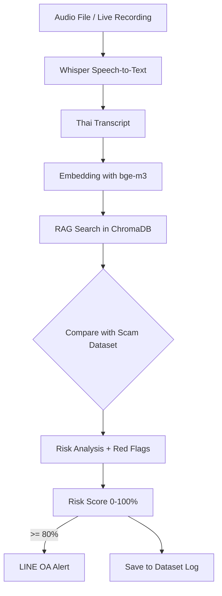

# 🛡️ AI Scam Call Detector

ระบบตรวจจับแก๊งคอลเซ็นเตอร์จากเสียงพูดภาษาไทย ด้วย Whisper + RAG + LINE OA Alert

## Features
- แปลงเสียงไทยเป็นข้อความด้วย faster-whisper
- ค้นหาสคริปต์สแกมเมอร์ด้วย RAG (ChromaDB + bge-m3)
- วิเคราะห์ Red Flags และให้คะแนนความเสี่ยง 0-100%
- แยกเสียงผู้พูด 2 คนด้วย pyannote (Optional)
- แจ้งเตือน LINE OA อัตโนมัติเมื่อเสี่ยง >= 80%
- Dashboard สรุปสถิติ

## Quick Start (Docker)
1. Copy `.env.example` เป็น `.env` แล้วใส่ LINE Token
2. รัน `docker compose up -d --build`
3. เปิดเว็บ https://scam.antiscamplus.org

## Run Local (Dev)
Terminal 1: `uvicorn main_api:app --port 8000`
Terminal 2: `streamlit run app.py`

## LINE Webhook
`https://scam.antiscamplus.org/line/webhook`

# 🛡️ AI Scam Call Detector

An AI-powered system to detect phone scam behavior from Thai speech using **Speech-to-Text, RAG, and LLM-based behavioral analysis**, with real-time alerts via LINE OA.

The system transcribes audio calls to text, compares the conversation against a scam-pattern database using Retrieval-Augmented Generation (RAG), and calculates a risk score to identify potential scammers.

**Live Demo:** https://scam.antiscamplus.org

---

## ✨ Features

- 🎙️ **Thai Speech-to-Text** - Transcribes audio using Faster Whisper (large-v3)
- 🔍 **RAG-Based Detection** - Matches conversations against a real scammer script database using Vector Search
- 👥 **Speaker Diarization** - Separates 2 speakers with pyannote and analyzes who is the potential scammer
- 📊 **Dashboard & Analytics** - Statistics, risk trends, scam types, and heatmaps
- 🚨 **Real-time LINE Alert** - Sends a Flex Message alert via LINE OA when Risk Score >= 80%
- 🐳 **Docker Ready** - One-command deployment with Docker Compose
- 🌐 **Production Ready** - Reverse Proxy + Free HTTPS with Caddy
- 🔄 **CI/CD** - Auto-deploy to VPS on every `git push` via GitHub Actions

---

## 🧠 How It Works



---

## 🛠️ Tech Stack

| Component | Technology |
|---|---|
| Speech-to-Text | faster-whisper |
| Embedding Model | BAAI/bge-m3 |
| Vector Database | ChromaDB |
| Speaker Diarization | pyannote.audio |
| Backend API | FastAPI |
| Frontend | Streamlit |
| Notification | LINE Messaging API |
| Reverse Proxy / HTTPS | Caddy |
| Deployment | Docker Compose, GitHub Actions |

---

## 📂 Project Structure

```
scam-detector/
├── .github/workflows/
│   └── deploy.yml          # Auto-deploy to VPS
├── data/
│   └── scam_dataset.csv    # Scam pattern dataset for RAG
├── app.py                  # Streamlit Web Client
├── main_api.py             # FastAPI Backend
├── detector.py             # Whisper + RAG + Risk Analysis
├── diarization.py          # Speaker diarization with pyannote
├── line_service.py         # LINE OA notification service
├── Dockerfile.api
├── Dockerfile.web
├── docker-compose.yml
├── Caddyfile               # Reverse proxy + HTTPS config
├── requirements-api.txt
├── requirements-web.txt
└── .env.example
```

---

## 🚀 Quick Start

### 1. Clone the repository

```bash
git clone https://github.com/YOUR_USERNAME/scam-detector.git
cd scam-detector
```

### 2. Configure environment variables

```bash
cp .env.example .env
```

Edit `.env`:

```env
LINE_CHANNEL_ACCESS_TOKEN=your_line_token_here
LINE_CHANNEL_SECRET=your_line_secret_here
LINE_ALERT_USER_ID=Uxxxxxxxxxxxxxxxxx
ALERT_THRESHOLD=80
HF_TOKEN=hf_xxxxxxxxxxxxxxxxx
```

### 3. Run with Docker (Recommended)

```bash
docker compose up -d --build
```

Open in your browser:

- Web App: http://localhost:8501
- API Docs: http://localhost:8000/docs

---

## 💻 Local Development (Without Docker)

**Terminal 1 - Backend:**

```bash
pip install -r requirements-api.txt
uvicorn main_api:app --host 0.0.0.0 --port 8000 --workers 1
```

**Terminal 2 - Frontend:**

```bash
pip install -r requirements-web.txt
streamlit run app.py
```

---

## 📲 LINE OA Setup

1. Create a Messaging API Channel at [LINE Developers Console](https://developers.line.biz)
2. Copy `Channel Access Token` and `Channel Secret` to your `.env` file
3. Set Webhook URL to:

```
https://scam.antiscamplus.org/line/webhook
```

4. Add the LINE OA as a friend and send any message to get your `User ID`

---

## 🌐 Production Deployment on VPS

### 1. Configure DNS

Create an `A` record:

| Type | Name | Value |
|---|---|---|
| A | scam | YOUR_VPS_IP |

Result: `scam.antiscamplus.org`

### 2. Deploy

```bash
cd /opt/scam-detector
docker compose up -d --build
docker compose ps
```

Caddy will automatically provision a free HTTPS certificate from Let's Encrypt.

### 3. Enable Auto-Deploy

Push to the `main` branch and GitHub Actions will automatically SSH into your VPS, pull the latest code, and rebuild Docker containers.

---

## 🔌 API Endpoints

| Method | Endpoint | Description |
|---|---|---|
| `GET` | `/health` | Health check |
| `POST` | `/analyze-text` | Analyze text for scam behavior |
| `POST` | `/analyze-audio` | Transcribe audio and analyze |
| `POST` | `/test-alert` | Test LINE alert |
| `GET` | `/logs` | Get detection history |
| `GET` | `/dataset` | Get RAG dataset |
| `POST` | `/line/webhook` | LINE Webhook receiver |

Interactive API documentation is available at `/docs`.

### Example Response

```json
{
  "is_scam": true,
  "risk_score": 92,
  "scam_type": "call_center",
  "red_flags": ["Impersonating an officer", "Urgency", "Money transfer request"],
  "evidence": ["You must transfer money within 1 hour"],
  "explanation": "Matched 96% with known call-center scam scripts in the database."
}
```

---

## ⚠️ Disclaimer

This system detects **scam behavior patterns** based on speech content, not psychological lie detection. Results should be interpreted as a **risk score**, not a definitive judgment. Always verify suspicious calls through official channels.

Audio recording and transcription must comply with applicable privacy laws (e.g., Thailand PDPA). Always obtain user consent before recording.

---

## 🗺️ Roadmap

- [x] Thai Speech-to-Text with Whisper
- [x] RAG-based scam pattern matching
- [x] Speaker diarization (2 speakers)
- [x] Dashboard and analytics
- [x] LINE OA real-time alerts
- [x] Docker + HTTPS production deployment
- [x] CI/CD with GitHub Actions
- [ ] User authentication (Admin / User roles)
- [ ] Automated nightly backups
- [ ] Mobile application

---

## 🤝 Contributing

Contributions are welcome! Please feel free to submit a Pull Request, especially for expanding the Thai scam dataset.

1. Fork the repository
2. Create your feature branch (`git checkout -b feature/amazing-feature`)
3. Commit your changes (`git commit -m 'Add amazing feature'`)
4. Push to the branch (`git push origin feature/amazing-feature`)
5. Open a Pull Request

---

## 📄 License

This project is licensed under the MIT License - see the [LICENSE](LICENSE) file for details.
